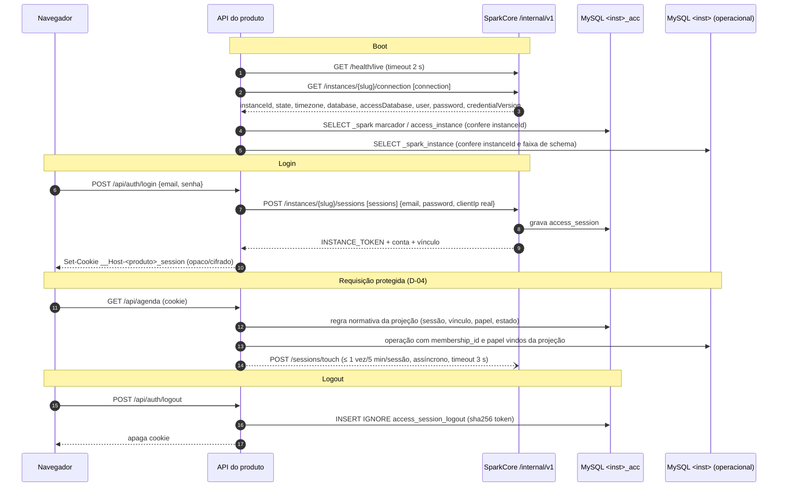

# 03 — Contrato de comunicação SaaS ↔ SparkCore

Padrão obrigatório para todo produto. Reúne o que o Tuteli pratica, o que os contratos já
especificam e as correções da auditoria de 15/11/2026. Onde o Tuteli diverge, a divergência está
anotada como **[Tuteli diverge]** e listada em [06](./06-conformidade-produtos.md).

Contratos normativos: [`openapi.yaml`](../../contracts/openapi.yaml) (`/internal/v1`),
[`access-projection.md`](../../contracts/access-projection.md) (v2),
[`conventions.md`](../../contracts/conventions.md), [`migration-artifact.md`](../../contracts/migration-artifact.md)
e [`openapi-f08.yaml`](../../specs/005-f08-core-auditoria-utilizacao/contracts/openapi-f08.yaml).

## Visão geral

## INT-001 — Credencial de aplicação

- `INT-001.1` Cada implantação (processo) do produto usa **credencial própria**, vinculada à
  **instância** (`app_credential.instance_id`), criada no Core com
  `npm run app-credential -- create <code> "<rótulo>" --instance <slug|uuid> --scopes ...`
  (`SEC-BASE-01`). Credencial só por produto é proibida para `connection`, `sessions` e
  `members`.
- `INT-001.2` Escopos mínimos: `connection` (somente o processo que abre a conexão),
  `sessions`, `members`; `utilizacao` para o trabalhador da outbox. Nada além do que o produto
  chama.
- `INT-001.3` Formato `Bearer <uuid>.<43 base64url>`; validado no boot por `env.ts`; nunca em
  log, URL, resposta, bundle do navegador ou mensagem de erro.
- `INT-001.4` Rotação sem parada: o Core aceita duas credenciais ativas do mesmo vínculo durante a
  janela; o produto lê a nova no reinício.

## INT-002 — Cliente do Core

- `INT-002.1` Todo acesso ao Core passa por um único módulo `api/src/core/` (cliente tipado a
  partir do OpenAPI). Rotas e serviços de domínio não chamam `fetch` para o Core diretamente.
- `INT-002.2` Toda chamada tem `AbortSignal.timeout` (padrão 3 s; boot 2 s) e propaga
  `X-Correlation-Id`. Timeout ou falha de rede → `503 AUTH_SERVICE_UNAVAILABLE` /
  `SYSTEM_DEPENDENCY_UNAVAILABLE` com `retryable: true` e `Retry-After` (`SEC-BASE-07`).
  **[Tuteli diverge: `requireAuth` e login sem timeout.]**
- `INT-002.3` A versão do contrato consumida (`/internal/v1` + revisão do CHANGELOG, hoje
  v1.3.3) é fixada no `plan.md` de cada fatia e em `docs/operacao/` do produto.

## INT-010 — Boot

1. Validar variáveis (`env.ts`). Falhar cedo sem imprimir valores.
2. `GET /health/live` com timeout de 2 s e mensagem acionável (padrão `verificar-core.ts` do Tuteli).
3. `GET /internal/v1/instances/{slug}/connection`. `409 INSTANCE_NOT_READY` → não aceitar tráfego
   protegido; repetir com espera progressiva.
4. Abrir os pools e conferir que `_spark_instance` (operacional) e `access_instance` (acesso)
   devolvem o mesmo `instanceId` entregue pelo Core, e que a versão de schema está na faixa
   suportada pela aplicação. Divergência → recusar com `503` e log de segurança.

## INT-020 — Conexão e pools

- `INT-020.1` Segredos de conexão só em memória do servidor. Pools separados para operacional e
  acesso, ambos vinculados a `instanceId` + `credentialVersion`. Sem `USE` entre requisições.
- `INT-020.2` Revalidar `/connection` a cada **10 min** (configurável) e ao receber erro de
  autenticação MySQL. Nova `credentialVersion` → criar pools novos e drenar os anteriores.
  `state` diferente de `ATIVA` → recusar operações protegidas e descartar pools
  (`SEC-BASE-19`). **[Tuteli diverge: pool em memória indefinidamente.]**
- `INT-020.3` TLS nos pools fora do desenvolvimento (`SEC-BASE-15`).

## INT-030 — Login

- `INT-030.1` `POST /api/auth/login` do produto chama `POST /internal/v1/instances/{slug}/sessions`
  com `email`, `password`, `clientIp` **real** e `userAgent`.
- `INT-030.2` `clientIp` vem do socket; `X-Forwarded-For` só é considerado quando a conexão vem de
  proxy listado em `TRUSTED_PROXIES`, usando o salto mais à direita não confiável
  (`SEC-BASE-02`). **[Tuteli diverge.]**
- `INT-030.3` Limite local por IP antes de chamar o Core (padrão: 20 tentativas/15 min/IP) →
  `429` com `Retry-After`.
- `INT-030.4` Resposta `401 AUTH_INVALID_CREDENTIALS` é única para todos os motivos; o produto não
  diferencia na interface.

## INT-040 — Cookie de sessão

- `INT-040.1` Nome `__Host-<produto>_session` quando houver HTTPS; `<produto>_session` apenas em
  desenvolvimento local HTTP.
- `INT-040.2` Atributos: `HttpOnly`, `Secure` (todo ambiente exceto desenvolvimento local),
  `SameSite=Strict`, `Path=/`, sem `Domain` (`SEC-BASE-05`, `SEC-BASE-06`).
- `INT-040.3` Conteúdo: **cifrado** (AES-256-GCM, chave derivada de `SESSION_SECRET`, com
  suporte a chaves anteriores para rotação) ou id opaco com estado no servidor. Contém
  `sparkToken`, `iat`, `exp`; **não** contém papel como autoridade. **[Tuteli diverge: payload só
  assinado, expõe token e e-mail; papel no cookie.]**
- `INT-040.4` `exp` do cookie ≤ expiração absoluta da sessão no Core (12 h); verificado no
  servidor.

## INT-050 — Autorização de cada requisição (D-04, normativo)

- `INT-050.1` Toda rota protegida executa a **regra normativa** de
  [`access-projection.md`](../../contracts/access-projection.md) no banco `_acc` da instância,
  usando `sha256(sparkToken)`. Zero linhas → `401` e cookie apagado.
- `INT-050.2` O **papel** e o `membership_id` usados na autorização vêm da linha retornada pela
  projeção, nunca do cookie. Isso fecha `SEC-BASE-04` sem depender de mudança no `touch`.
- `INT-050.3` Perfil operacional local (quando o produto tiver) é carregado do banco operacional
  pelo `membership_id` da projeção.
- `INT-050.4` Com o Core fora do ar e a projeção acessível, sessões válidas continuam operando até
  vencerem; login, convites e mudança de membros ficam `503`. Projeção inacessível → `503`.
- `INT-050.5` **[Tuteli diverge]**: o Tuteli usa `POST /sessions/touch` síncrono como guarda de
  cada requisição e papel do cookie. A migração do Tuteli para `INT-050` resolve, juntos,
  `SEC-04` e `SEC-07`.

## INT-051 — Atividade (touch)

- `INT-051.1` O produto chama `POST /internal/v1/instances/{slug}/sessions/touch`
  (`X-Instance-Session`) **no máximo uma vez a cada 5 min por sessão**, fora do caminho crítico
  (após responder ou em fila em memória), com timeout de 3 s.
- `INT-051.2` `401` do touch → marcar a sessão local como inválida (próxima requisição recebe
  `401`). Falha de rede → ignorar e tentar no próximo intervalo; a inatividade continua medida
  pelo Core.
- `INT-051.3` Contrato v1.4 (SEC-04 no Core): `touch` responde `200 {role, membershipStatus}`;
  produtos em `INT-050` podem ignorar o corpo. Aceitar também `204` de Core anterior.

## INT-060 — Logout

`POST /api/auth/logout` grava `INSERT IGNORE INTO access_session_logout (id_hash, ended_at) VALUES
(SHA2(?,256), UTC_TIMESTAMP(6))` na conexão de acesso **antes** de apagar o cookie; falha na
gravação é registrada, e o cookie é apagado mesmo assim (`SEC-BASE-03`). **[Tuteli diverge.]**

## INT-070 — Equipe, convites e recuperação

- `INT-070.1` Listar, convidar, revogar convite, mudar papel e revogar vínculo **somente** pelas
  rotas `/internal/v1/instances/{slug}/members*` e `/invitations*` (escopo `members`), enviando a
  sessão do ator em `X-Instance-Session`. O Core decide a permissão (administrador local) e a
  regra do último administrador.
- `INT-070.2` O produto nunca grava vínculo, papel ou senha no próprio banco. Cadastros locais que
  referenciam pessoas (profissional, perfil) usam `membershipId`/`accountId` opacos devolvidos pelo
  Core (`accountId` desde v1.3.2).
- `INT-070.3` Aceite de convite e recuperação de senha acontecem nas páginas do Core
  (`/convite/:token`, `/redefinir-senha/:token`); o produto exibe o link de retorno à sua tela de
  login.

## INT-080 — Utilização (F08)

- `INT-080.1` Eventos de contagem nascem numa tabela `outbox_evento` **no mesmo commit** da
  operação que os origina.
- `INT-080.2` Trabalhador do produto envia lotes para
  `POST /internal/v1/instances/{instanceId}/usage-batches` (escopo `utilizacao`), com `batch_id`
  e `event_id` estáveis, `occurred_at` UTC, `kind` e `count`; retentativa com espera progressiva
  e limite; nunca envia nomes, valores, itens ou observações.
- `INT-080.3` `kind` novo DEVE ser cadastrado no Core antes do uso. Reconhecidos hoje:
  `atendimentos_iniciados`, `atendimentos_concluidos`, `vendas_confirmadas`.
- `INT-080.4` Falha de telemetria nunca desfaz operação de negócio.

## INT-090 — Convenções de API do produto

O produto expõe ao seu navegador `/api/...` seguindo as mesmas [convenções](../../contracts/conventions.md)
do Core: JSON `camelCase`, envelope de erro `{error:{code,message,field,retryable,correlationId}}`,
`X-Correlation-Id` (aceita só UUID, `SEC-BASE-17`), `Idempotency-Key` nas mutações críticas,
dinheiro em `*Cents`, `404` idêntico para inexistente e de outro contexto, `409` para versão ou
idempotência, `422` para validação, `503` para dependência, `500` genérico com
`app.onError` (`SEC-BASE-18`). Corpo só `application/json` (`SEC-BASE-05`), limite 1 MiB
(`SEC-BASE-08`), paginação com teto (`SEC-BASE-20`).

## INT-100 — Ciclo de vida da instância

| Estado na projeção | Comportamento do produto |
| --- | --- |
| `pronta` | Login recusado (`401`); página de aceite de convite no Core funciona. |
| `ativa` | Operação normal. |
| `suspensa` | Toda requisição protegida `401`; tela de login mostra indisponibilidade genérica. Reativação exige novo login (revisão de autorização). |
| `manutencao` | Igual a suspensa para usuários; tarefas de segundo plano param antes de efeitos novos. |

Restauração de backup segue [`docs/operacao/backup-restauracao.md`](../operacao/backup-restauracao.md):
reconciliação da projeção antes de liberar, sessões restauradas invalidadas.

## INT-110 — Testes de contrato obrigatórios por produto

1. Credencial da instância A pedindo `/connection`, `/sessions`, `/sessions/touch` e `/members` de
   B → recusa idêntica a inexistente.
2. Login, requisição protegida, logout e reuso do cookie antigo → `401`.
3. Rebaixar papel no Core → próxima escrita de administrador no produto → `403`.
4. Revogar vínculo em A preservando B; suspender A e reativar com novo login.
5. Core fora do ar com sessão válida → leitura funciona; login → `503`; perda da projeção → `503`.
6. `X-Forwarded-For` variado do mesmo socket sem proxy confiável → limitado; IP real no evento.
7. Lote de utilização repetido → contado uma vez no Core.
