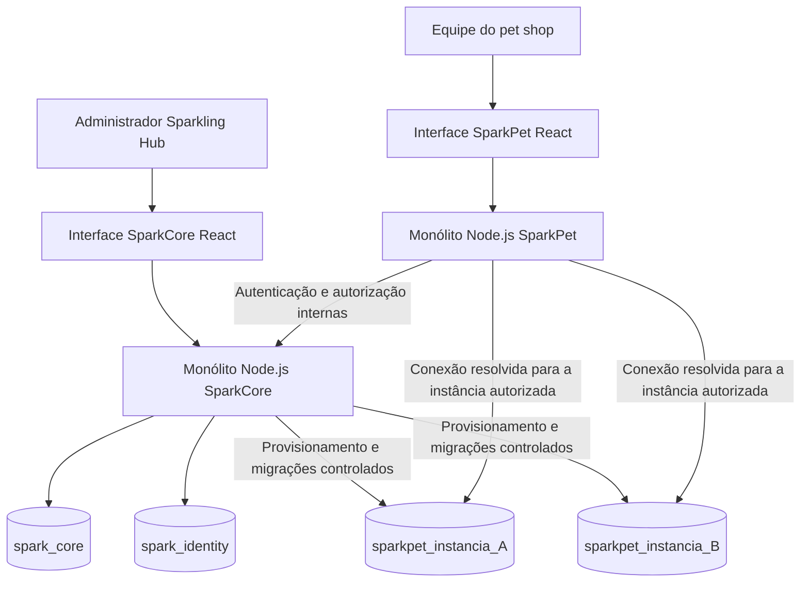

# Diretrizes compartilhadas — SparkCore e SparkPet

**Versão:** 1.0 · **Data:** 25/10/2026 · **Natureza:** proposta de arquitetura e critérios comuns.

## 1. Objetivos e vocabulário

O SparkCore administra a oferta dos SaaS da Sparkling Hub. O SparkPet administra a rotina do estabelecimento contratante. A separação de responsabilidades deve existir no código, nas permissões e nos dados.

| Termo | Definição |
|---|---|
| Plataforma | Conjunto de produtos e recursos administrados pela Sparkling Hub. |
| Contratante | Pessoa jurídica ou física que contrata um SaaS; cadastro comercial no SparkCore. |
| Produto | SaaS habilitado no catálogo, inicialmente SparkPet. |
| Instância / tenant | Ambiente lógico de um contratante em um produto, com identificador imutável, estado, usuários autorizados e banco operacional exclusivo. Não significa necessariamente um servidor ou contêiner dedicado. |
| Estabelecimento | Unidade de operação de um pet shop; no MVP, uma por instância SparkPet. |
| Tutor / cliente do pet shop | Pessoa que contrata serviços ou compra produtos dentro do SparkPet. Não se confunde com o contratante da Sparkling Hub. |
| Usuário | Pessoa autenticada, com vínculos e papéis explícitos em um contexto. |
| Profissional | Pessoa agendável para executar serviços; pode ter ou não uma conta de usuário. |
| Administrador da plataforma | Usuário interno do SparkCore. |
| Administrador do estabelecimento | Usuário do SparkPet que administra apenas sua instância. |
| Movimento comercial | Comanda/venda de produtos, serviços ou pacote; separado de lançamento de estoque, de recebimento e de evento de utilização. |
| Inativação | Impede novo uso de um cadastro; mantém referências históricas. |
| Suspensão | Bloqueia o acesso operacional à instância, preservando dados e contrato administrativo. |

## 2. Restrições confirmadas e decisões propostas

### 2.1 Restrições do pedido

- `COM-001 [U]` Front-end em React + TypeScript e Tailwind CSS nos dois produtos. Tailwind fornece a camada de estilos; os componentes React precisam de comportamento, semântica e acessibilidade próprios.
- `COM-002 [U]` Back-end em Node.js.
- `COM-003 [U]` Persistência em MySQL.
- `COM-004 [U]` MVP em arquitetura monolítica, sem exigir microserviços para entregar a operação.
- `COM-005 [U]` Banco operacional próprio para cada nova instância de SaaS.
- `COM-006 [U]` Banco de autenticação de usuários para SparkPet.

### 2.2 Decisões de referência

| ID | Proposta | Consequência / decisão necessária |
|---|---|---|
| D-01 | Dois monólitos modulares, um por produto; identidade central dentro do SparkCore. | **Confirmar antes de implementar a base.** O pedido não esclarece se desejava um único executável para todo o ecossistema. |
| D-02 | `spark_identity` central para contas, vínculos, convites e sessões de ambos os produtos. | **Confirmar antes de modelar identidade.** Resolve o requisito do banco de autenticação sem copiar senhas para cada instância. |
| D-03 | Uma instância SparkPet = um estabelecimento, com agenda e estoque únicos. | **Confirmar antes da modelagem operacional.** Várias filiais usam instâncias separadas, sem consolidação operacional no MVP. |
| D-04 | Autorização de cada requisição protegida do SparkPet consultada no módulo de identidade do SparkCore por API interna. | **Confirmar antes de implementar segurança.** Simplifica revogação imediata, mas torna Core/identidade dependência síncrona do Pet. |
| D-05 | Node.js também com TypeScript; API HTTP JSON; migrações versionadas; testes contra MySQL real. | Selecionar framework, biblioteca de acesso a dados e versões no planejamento técnico, documentando a escolha. |
| D-06 | Cobrança da assinatura administrada externamente; suspensão manual com motivo. | Sem gateway de assinatura, cobrança recorrente ou bloqueio automático por falta de pagamento. |
| D-07 | Convite e recuperação com link individual de uso único; entrega manual segura no MVP, e-mail transacional como opção. | Definir canal e verificação de destinatário antes do piloto. Nunca usar senha padrão enviada ao cliente. |
| D-08 | Pacote pré-pago por animal e um tipo de serviço; saldo em créditos inteiros. | Validar com os pilotos antes de construir o módulo; pacotes mistos e compartilhados ficam fora. |
| D-09 | BRL, pt-BR e fuso configurável por estabelecimento, inicialmente `America/Sao_Paulo`. | Datas e períodos de relatório usam o fuso da instância; armazenamento temporal segue regras abaixo. |
| D-10 | Estoque não negativo e sem reserva em comanda de rascunho; agenda sem sobreposição autorizável. | Operação pode exigir ajuste de cadastro ou outra disponibilidade, sem exceção silenciosa. |
| D-11 | Recebimentos manuais; sem captura de cartão, confirmação bancária de Pix ou integração fiscal. | O operador informa um recebimento efetivamente ocorrido. |
| D-12 | Metas de capacidade, retenção e recuperação deste documento são valores de planejamento. | Confirmar após dimensionar infraestrutura e dados do piloto; não são SLA comercial. |

Uma decisão alterada deve gerar registro de arquitetura e revisão dos requisitos, cenários e estimativas afetados. A pendência de uma decisão não autoriza construir duas alternativas completas.

## 3. Arquitetura de referência

### 3.1 Componentes e responsabilidade

O diagrama mostra acesso técnico de provisionamento aos bancos das instâncias. Isso não concede ao administrador da plataforma navegação nas comandas, tutores ou animais do SparkPet.

**SparkCore:** módulos de identidade, contratantes, produtos, instâncias, provisionamento, auditoria, acesso e utilização. O executor de tarefas usa o mesmo código e o mesmo artefato de implantação do Core, podendo rodar como processo trabalhador. Uma tabela de tarefas persistentes no MySQL evita exigir um broker externo no MVP.

**SparkPet:** módulos de configuração do estabelecimento, usuários locais por vínculo, tutores/animais, catálogo, agenda, atendimento, comercial, pacotes, estoque, recebimentos, relatórios e auditoria. Transações operacionais ficam no banco da própria instância.

**Banco de identidade:** pertence ao módulo de identidade do SparkCore. O SparkPet não acessa suas tabelas diretamente e não mantém segunda cópia de senha. A centralização é uma recomendação, não uma restrição expressa no pedido original.

**Migrações:** cada produto publica artefatos versionados e verificados de migração. O Core só executa versões cadastradas, sem aceitar SQL livre pela interface. O trabalhador usa credencial própria de provisionamento; as credenciais operacionais do SparkPet não têm permissão para criar bancos ou alterar estruturas.

### 3.2 Dependência e indisponibilidade

No modelo proposto, login, validação de sessão e mudanças de usuários dependem do Core/identidade. A interface administrativa do Core pode falhar sem afetar o Pet se sua API interna continuar saudável; a indisponibilidade da API de identidade bloqueia novas requisições protegidas do Pet com erro temporário `503`. Não existe funcionamento offline ou autorização baseada apenas em dados antigos do navegador.

O MVP não terá cache positivo de autorização. O planejamento deve medir a latência adicional, a carga e a disponibilidade dessa consulta. Se a dependência for inaceitável, revisar `D-04` antes da implementação; tokens validados localmente exigiriam uma estratégia diferente para revogação e suspensão.

### 3.3 Monólito e evolução

Cada produto tem uma base de código e fronteiras de módulos explícitas. São permitidos pacotes internos compartilhados para contratos e componentes. Não se exige Kubernetes, mensageria distribuída, service mesh, event sourcing ou banco por módulo. A implantação do site institucional existente é independente destes produtos.

## 4. Identidade, autorização e ciclo de acesso

### 4.1 Modelo de identidade

- `COM-007 [P]` Conta central identificada por UUID e e-mail normalizado único segundo política documentada. Não remover pontos ou sufixos de endereços como se todos os provedores fossem equivalentes.
- `COM-008 [P]` Papel de plataforma em vínculo próprio; papéis de produto em `membership(user_id, instance_id, role, status)`. Um usuário pode integrar várias instâncias e ter papéis diferentes em cada uma.
- `COM-009 [P]` A conta não ganha acesso a outra instância pelo mesmo e-mail, domínio, contratante ou papel em uma instância anterior. O acesso exige novo vínculo explícito.
- `COM-010 [P]` O administrador da plataforma não recebe implicitamente o papel de administrador de estabelecimento. Impersonação e acesso de suporte ao conteúdo operacional ficam fora do MVP.
- `COM-011 [P]` Convite concede apenas um vínculo aprovado. Se a conta já existir, a aceitação exige autenticação dessa conta; não redefine sua senha e não revela ao pet shop seus outros vínculos.
- `COM-012 [P]` O administrador do SparkPet gerencia vínculos da sua instância, sem bloquear a conta global, consultar outros clientes ou redefinir a senha global de terceiros.

### 4.2 Sessões e credenciais

- `COM-013 [P]` Login com e-mail e senha, logout e recuperação. Senhas armazenadas por algoritmo específico para senhas, como Argon2id, com parâmetros definidos no plano de segurança; nunca criptografia reversível.
- `COM-014 [P]` Sessão opaca mantida no servidor; navegador recebe cookie `Secure`, `HttpOnly`, de host e escopo adequados. Não persistir credenciais de sessão em `localStorage`.
- `COM-015 [P]` Separar sessões por aplicação e contexto de instância. O cookie do SparkPet não autentica automaticamente a interface do SparkCore. Trocar de instância cria ou seleciona sessão explicitamente autorizada para o novo contexto.
- `COM-016 [P]` Proposta inicial de expiração: Core com 30 minutos de inatividade e 8 horas absolutas; Pet com 2 horas de inatividade e 12 horas absolutas. A atualização de atividade pode ser agrupada, sem permitir ultrapassar a expiração absoluta. Sem opção de sessão permanente no MVP.
- `COM-017 [P]` MFA TOTP obrigatório para administrador da plataforma antes de provisionar ou suspender instâncias; recuperação por códigos de uso único e procedimento administrativo documentado. MFA do SparkPet fica como evolução.
- `COM-018 [P]` Após alteração de senha ou bloqueio global, revogar as sessões da conta. Após revogar vínculo, revogar apenas as sessões daquele contexto. Após suspensão, bloquear todas as sessões daquela instância sem atingir outras.
- `COM-019 [P]` Convite expira em 48 horas; link de recuperação em 30 minutos; uso único, segredo aleatório, persistência somente de resumo criptográfico e revogação ao reenviar. Os prazos são propostas configuráveis.
- `COM-020 [P]` Bootstrap do primeiro administrador por procedimento de implantação protegido, sem cadastro público de administrador. Nunca permitir remover ou inativar o último administrador ativo de uma plataforma ou instância utilizável. Na primeira ativação de instância, um convite inicial válido pode cumprir a condição de bootstrap até sua aceitação; se expirar, somente a plataforma pode renová-lo. A página de aceitação permite criar/autenticar a conta e aceitar o vínculo sem liberar operações de negócio antes de a instância estar ativa.

### 4.3 Verificação de uma requisição SparkPet

1. Resolver a instância por rota ou host previamente cadastrado; valor enviado pelo navegador é um seletor, não prova de autorização.
2. Extrair a sessão opaca do cookie e consultar o endpoint interno de autorização do Core, com autenticação da aplicação chamadora e contexto de rota.
3. Core verifica sessão, audiência, conta, vínculo, papel, estado e versão de autorização da instância. Responde apenas com o contexto mínimo necessário.
4. SparkPet verifica a permissão da ação e resolve a conexão operacional pelo identificador de instância obtido do servidor.
5. Executar a operação e registrar ator e instância. Não aceitar `user_id`, `role`, nome do banco ou conexão enviados pelo cliente como autoridade.

A comunicação interna usa TLS, credencial de aplicação com escopo e rotação e rede restrita. Para operações interativas, a credencial do servidor não substitui a autorização do usuário. Operações de provisionamento usam identidade de sistema distinta, tarefa e instância vinculadas.

Negação de acesso não deve revelar a existência de um objeto de outra instância. Respostas `401`, `403`, `404`, `409`, `422` e `503` precisam de política consistente no contrato.

## 5. Isolamento e provisionamento

### 5.1 Fronteiras dos dados

| Banco | Dados | Acesso de aplicação |
|---|---|---|
| `spark_core` | Contratantes, produtos, instâncias, tarefas, auditoria da plataforma e métricas agregadas. | Módulos Core, com privilégios separados entre execução web e provisionamento. |
| `spark_identity` | Contas, credenciais, vínculos, convites, sessões e auditoria de segurança. | Módulo de identidade no Core. |
| `sparkpet_<id_interno>` | Dados de negócio de um estabelecimento, configurações, auditoria operacional e outbox. | SparkPet com credencial exclusiva da instância; trabalhador autorizado para migrações. |

Não haverá chaves estrangeiras entre bancos operacionais e identidade. UUIDs de ator e instância são referências externas verificadas na aplicação; o histórico preserva identificador e nome de exibição do ator na época, sem depender de conta continuar ativa. Dentro de cada banco, usar integridade referencial normal.

Cada pool de conexão é associado a uma única instância e credencial. É vedado compartilhar conexão mutável que troca de banco por `USE` entre requisições. Pools têm limite por instância, teto global e descarte por ociosidade; criação de milhares de conexões por crescimento do cadastro não é aceitável.

### 5.2 Segurança da criação de bancos

O banco recebe nome derivado de identificador interno validado, nunca do nome comercial. O segredo de conexão fica em armazenamento de segredos ou cifrado com chave externa ao banco, conforme infraestrutura escolhida. Nem a tela, o log, o CSV ou o histórico de tarefa exibem a senha.

O provisionamento não deve ser descrito como uma transação SQL única. Comandos como `CREATE DATABASE` e operações de administração podem realizar commits implícitos no MySQL; a estratégia precisa de etapas persistidas, verificações, compensações limitadas e retomada. Ver [documentação oficial do MySQL sobre commits implícitos](https://dev.mysql.com/doc/refman/8.4/en/implicit-commit.html).

Se uma etapa falhar, a instância permanece indisponível; recursos parciais são identificados e protegidos. O trabalhador não remove automaticamente um banco com dados operacionais. Limpeza de recurso vazio só pode ocorrer por política explícita, com prova de propriedade, registro e procedimento operacional.

## 6. Contratos entre produtos

### 6.1 Capacidades mínimas da API interna

O plano técnico definirá rotas e schemas; as capacidades obrigatórias são:

| Capacidade | Consumidor | Regra |
|---|---|---|
| Autenticar e encerrar sessão Pet | SparkPet | Aplicação e instância explícitas; segredo nunca registrado em log. |
| Autorizar sessão e resolver instância | SparkPet | Retorna identidade, papel, estado autorizado, revisão e referência opaca de conexão. |
| Listar/criar/revogar vínculos locais | Administração SparkPet | Revalida a sessão e papel do administrador local; não aceita escolher outra instância. |
| Criar convite inicial | Provisionamento Core | Só após schema e configuração verificados; reenvio idempotente não duplica vínculo. |
| Receber lote de utilização | Outbox SparkPet | Instância derivada da credencial/contexto de serviço e confrontada com cada evento. |
| Consultar situação operacional | SparkCore | Healthcheck técnico e versão, sem ler conteúdo de tutores ou vendas. |

Aplicar versão ao contrato. Respostas de erro incluem código estável, mensagem segura, campo quando cabível, possibilidade de repetição e identificador de correlação. Nenhuma falha deve retornar SQL, segredo ou stack trace ao usuário.

### 6.2 Eventos de utilização e confiabilidade

Eventos possuem `event_id`, versão, produto, instância, instante UTC, tipo e quantidades permitidas. `actor_id` só quando necessário para acesso e contagem de usuários ativos; eventos agregados de negócio não carregam tutor, pet, itens, notas, receita ou conteúdo de atendimento. Para dias de uso e usuários ativos, definir um evento mínimo de atividade autenticada, com identificador de usuário, emitido por caminhos operacionais elegíveis e sem polling/healthcheck. O contrato distingue essa atividade das contagens de transações concluídas.

O SparkPet registra evento em outbox no mesmo commit da operação quando a métrica deriva de gravação. Um trabalhador do mesmo produto entrega lotes com repetição e espera progressiva. Core deduplica por `event_id` e instância. Sucesso no envio não exige apagar imediatamente a evidência local; a política de retenção define a limpeza.

Falha de telemetria não desfaz a venda nem impede atendimento, desde que identidade continue disponível e a outbox tenha capacidade. Ao atingir limite de armazenamento, gerar alerta e política explícita; nunca descartar silenciosamente eventos ou preencher lacuna com zero. Métricas têm horário de atualização e indicação de incompletude.

Eventos de acesso são produzidos pelo módulo de identidade, inclusive falha de login, logout e revogação. Não inferir tempo efetivo de trabalho apenas pela duração da sessão.

## 7. Invariantes de dados e concorrência

- `COM-021 [P]` Valores em BRL usam centavos inteiros no contrato e cálculo; no MySQL, tipo exato coerente. Nunca ponto flutuante para saldo ou total.
- `COM-022 [P]` Quantidade de produto usa unidade inteira; insumos aceitam decimal com até três casas na unidade cadastrada. Conversão automática entre unidades fica fora.
- `COM-023 [P]` Instantes são gravados em UTC; data civil, validade e horário de expediente são tratados no fuso do estabelecimento. Períodos são intervalos `[início, fim)`; uma busca até 31/10 inclui o dia inteiro local sem truncar às 00h.
- `COM-024 [P]` Toda alteração de saldo usa livro de lançamentos e origem identificável. Saldos projetados devem reconciliar com os lançamentos.
- `COM-025 [P]` Estoque, créditos, recebimentos, número de usuários e capacidade da agenda precisam de trava/transação apropriada. Uma consulta prévia sem proteção contra corrida não basta.
- `COM-026 [P]` Requisições críticas têm chave de idempotência vinculada a ator/instância/operação, resumo do payload e resposta persistida por pelo menos 24 horas. Mesma chave e dados repetem resultado; dados diferentes retornam conflito. Origens de estoque e pacote mantêm unicidade permanente.
- `COM-027 [P]` Edição concorrente de cadastro, agenda e rascunho usa versão otimista ou controle equivalente; conflito deve pedir recarga, preservando os dados digitados quando possível.
- `COM-028 [P]` Cadastros usados são inativados; operações confirmadas recebem compensação ou estado de cancelamento, sem apagamento de histórico. Exclusão física de dados pessoais segue procedimento específico de retenção e não a rotina comum de apagar cadastro.

## 8. Requisitos não funcionais verificáveis

As metas numéricas abaixo são propostas de engenharia para dimensionamento inicial, sujeitas a `D-12`.

| ID | Requisito e meta inicial | Como demonstrar |
|---|---|---|
| NFR-001 | React + TypeScript + Tailwind; Node.js; MySQL. | Inspeção da solução, dependências e execução documentada. |
| NFR-002 | Navegação utilizável de 360 px a desktop; agenda alternativa em lista no celular; teclado e leitores de tela nas tarefas críticas. | Homologar login, agendamento e recebimento em computador e celular; verificar rótulos, foco, contraste e erros. Usar WCAG AA como alvo de projeto, sem alegar certificação. |
| NFR-003 | Alvo de carga: 50 instâncias, 200 usuários cadastrados no conjunto e 40 usuários simultâneos, até 100 mil movimentos na instância maior. | Ensaio com dados sintéticos, distribuição e infraestrutura descritas; ajustar o limite comercial ao resultado. |
| NFR-004 | p95 até 800 ms em leitura e 1,5 s em gravação comum, medidos no servidor incluindo a autorização; até 3 s para a primeira agenda do dia em conexão de teste acordada. | Teste de carga do perfil NFR-003 e medição da jornada em navegador; relatar rede e amostra. Provisionamento e exportação têm metas próprias. |
| NFR-005 | Relatório interativo até 31 dias; consulta até 366 dias via exportação paginada/assíncrona quando exceder limite. | Consultar volume máximo, sem bloquear o servidor ou carregar tudo na memória. |
| NFR-006 | Objetivo inicial de disponibilidade mensal de 99,5% do caminho de acesso, incluindo identidade e banco, sem converter isto em SLA contratado. | Monitoramento externo e método documentado de contagem; dependências e manutenção visíveis. |
| NFR-007 | Backups automáticos pelo menos diários, cifrados e fora do servidor da aplicação; objetivo RPO de 24h e RTO de 8h. | Restauração em ambiente separado antes do piloto e ensaio periódico, com tempos e perdas medidos. |
| NFR-008 | Nenhum acesso entre instâncias ou ganho de papel por parâmetros do cliente. | Testes negativos de API, sessão, conexão reutilizada, exportação, telemetria e tarefas com duas instâncias. |
| NFR-009 | Tráfego protegido por TLS em produção; credenciais por ambiente; privilégio mínimo; limitação de tentativas; proteção CSRF e contra injeção e XSS. | Revisão de ameaça e testes das fronteiras, sem segredo em código, navegador, CSV ou logs. |
| NFR-010 | Logs estruturados com correlação, produto e contexto de instância verificado; métricas de erro, fila, provisionamento, autorização e backup. | Rastrear um erro do navegador até o evento e a tarefa, preservando conteúdo confidencial. |
| NFR-011 | Dados e contratos versionados; migrações reproduzíveis em banco vazio e em versão anterior suportada. | Pipeline executa migração e testes contra MySQL da versão adotada. |
| NFR-012 | Processo de entrega com verificação de tipos, análise estática, testes de regras críticas, integração e jornadas de ponta a ponta. | Evidências relacionadas aos requisitos; cobertura percentual isolada não é aceite. |
| NFR-013 | Nenhuma confirmação de venda, recebimento ou pacote duplicada por repetição ou concorrência. | Repetir chamada após timeout e disputar a última unidade/crédito. |
| NFR-014 | Filas sobrevivem a reinício; tarefas com trava, heartbeat, tentativas limitadas e falha visível. | Interromper o trabalhador entre etapas, reiniciar e conferir retomada sem efeitos duplicados. |
| NFR-015 | Navegadores homologados nas versões estáveis atual e anterior de Chrome, Edge, Firefox e Safari na data do piloto. | Registrar versões e jornadas; não presumir compatibilidade apenas pelo desktop. |
| NFR-016 | Dados de demonstração sintéticos; ambientes de desenvolvimento e homologação sem cópia irrestrita de produção. | Inspecionar carga de dados e procedimento de acesso de equipe. |

## 9. Privacidade, retenção e continuidade

Coletar apenas os campos necessários para cada finalidade; CPF, endereço, foto e informações complementares do tutor não são obrigatórios por conveniência do cadastro. Cuidados sobre o animal são informações operacionais informadas pelo tutor, sem transformá-las em diagnóstico ou prontuário veterinário.

O planejamento deve definir responsabilidades de tratamento, avisos de privacidade, canal de solicitações e critérios de retenção por classe de dado. Não é correto prometer conformidade legal apenas pela inclusão de funcionalidades. O [guia de segurança da ANPD para agentes de pequeno porte](https://www.gov.br/anpd/pt-br/centrais-de-conteudo/materiais-educativos-e-publicacoes/processo-guia-orientativo-sobre-seguranca-da-informacao-para-agentes-de-tratamento-de-pequeno-porte.pdf) apoia a elaboração das medidas de acesso e continuidade; a política aplicável ao negócio deve ser validada antes da produção.

**Proposta inicial operacional:** métricas agregadas por 13 meses; eventos de acesso detalhados por 90 dias; backups diários por 30 dias; auditoria de alterações por 12 meses. Esses valores não definem prazo legal para documentos financeiros, contratos ou dados de clientes. Retenção desses registros e eventual obrigação de preservação são bloqueadores de produção a resolver com os responsáveis do negócio.

Solicitação de exportação/eliminação de titular terá procedimento assistido e auditável no MVP, com validação de identidade, escopo e impedimentos de retenção. Não haverá botão genérico para apagar uma instância nem exclusão indiscriminada de históricos financeiros. A política precisa alcançar exportações, cópias de segurança, logs e dados recuperados.

Restaurar banco operacional de uma instância exige colocá-la em manutenção, recuperar em destino separado, conferir identificadores e integridade e só então trocar o apontamento. Reaplicar vínculos, revogações e suspensão atuais; uma cópia antiga não pode ressuscitar permissões revogadas. Recuperação conjunta de Core e identidade tem procedimento próprio e reconciliação com o catálogo de bancos existentes.

## 10. Referências e natureza das recomendações

As regras de negócio, metas e decisões deste pacote são propostas elaboradas para a Sparkling Hub. As fontes abaixo foram usadas como verificação pontual de riscos, não como definição automática do escopo:

- A separação de credenciais, escopo de instância e validação de fronteiras é apoiada pela [OWASP — segurança em aplicações multi-tenant](https://cheatsheetseries.owasp.org/cheatsheets/Multi_Tenant_Security_Cheat_Sheet.html).
- Os cuidados com cookie, expiração e revogação de sessão são apoiados pela [OWASP — gerenciamento de sessões](https://cheatsheetseries.owasp.org/cheatsheets/Session_Management_Cheat_Sheet.html).
- A necessidade de tratar provisionamento por etapas considera a [documentação MySQL sobre commits implícitos](https://dev.mysql.com/doc/refman/8.4/en/implicit-commit.html).

A seleção de versões, framework, bibliotecas, provedor de infraestrutura e ferramenta de migração é uma atividade do plano técnico. Não foi usada a tecnologia Astro do site institucional como requisito dos novos produtos.
